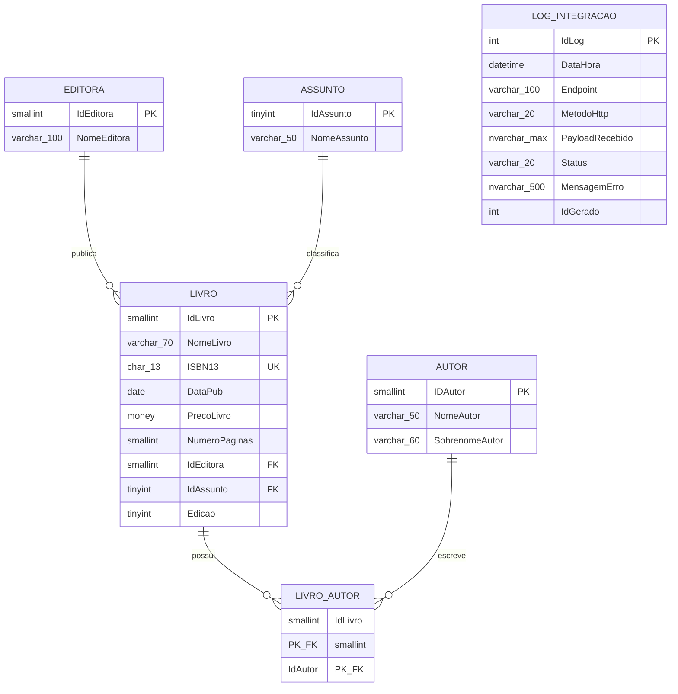

# Documentação (Parte 13) — Mapeamento do Banco de Dados `Biblioteca`

Documentação de referência da estrutura completa do banco `Biblioteca`, gerada a partir de uma extração direta dos metadados do SQL Server (`INFORMATION_SCHEMA`, `sys.identity_columns`). Serve como mapa de consulta rápida do modelo de dados por trás da API, complementando a documentação de código já existente (Partes 1 a 12).

> **Nota:** a extração trouxe também objetos de sistema do SQL Server (ex: `sysdiagrams`, estruturas internas de infraestrutura) e uma tabela `Surf`, sem relação aparente com o domínio da biblioteca — provavelmente remanescente de outro exercício. Esses itens foram deixados de fora deste mapeamento, que cobre apenas as 6 tabelas do domínio `Biblioteca`.

---

## Diagrama Entidade-Relacionamento

> **Nota sobre `LogIntegracao`:** essa tabela não possui chave estrangeira para nenhuma outra — ela é independente, funcionando como um registro de auditoria que referencia IDs de outras tabelas apenas por valor (`IdGerado`), sem uma restrição formal de integridade referencial. Isso é intencional: o log precisa continuar existindo mesmo que o registro original (ex: um livro deletado) não exista mais.

---

## Tabelas e colunas

### `Livro` — tabela central do domínio

| Coluna | Tipo | Nulo? | Observação |
|---|---|---|---|
| `IdLivro` | `smallint` | Não | **PK**, `IDENTITY` (auto-incremento) |
| `NomeLivro` | `varchar(70)` | Não | |
| `ISBN13` | `char(13)` | Não | **UNIQUE** (constraint `UQ__Livro__...`) — impede ISBN duplicado |
| `DataPub` | `date` | Sim | |
| `PrecoLivro` | `money` | Não | |
| `NumeroPaginas` | `smallint` | Não | |
| `IdEditora` | `smallint` | Não | **FK** → `Editora.IdEditora` |
| `IdAssunto` | `tinyint` | Não | **FK** → `Assunto.IdAssunto` |
| `Edicao` | `tinyint` | Sim | |

### `Editora`

| Coluna | Tipo | Nulo? | Observação |
|---|---|---|---|
| `IdEditora` | `smallint` | Não | **PK**, `IDENTITY` |
| `NomeEditora` | `varchar(100)` | Não | Ampliada de `varchar(50)` na Parte 11 |

### `Assunto`

| Coluna | Tipo | Nulo? | Observação |
|---|---|---|---|
| `IdAssunto` | `tinyint` | Não | **PK**, `IDENTITY` |
| `NomeAssunto` | `varchar(50)` | Não | Ampliada de `varchar(25)` na Parte 11 |

### `Autor`

| Coluna | Tipo | Nulo? | Observação |
|---|---|---|---|
| `IDAutor` | `smallint` | Não | **PK**, `IDENTITY` |
| `NomeAutor` | `varchar(50)` | Não | |
| `SobrenomeAutor` | `varchar(60)` | Não | |

### `LivroAutor` — tabela associativa (N:N)

| Coluna | Tipo | Nulo? | Observação |
|---|---|---|---|
| `IdLivro` | `smallint` | Não | **PK composta** + **FK** → `Livro.IdLivro` |
| `IdAutor` | `smallint` | Não | **PK composta** + **FK** → `Autor.IDAutor` |

Resolve o relacionamento **muitos-para-muitos** entre livros e autores: um livro pode ter vários autores, e um autor pode ter escrito vários livros. Sem colunas próprias além das duas chaves.

### `LogIntegracao` — auditoria (independente do domínio)

| Coluna | Tipo | Nulo? | Observação |
|---|---|---|---|
| `IdLog` | `int` | Não | **PK**, `IDENTITY` |
| `DataHora` | `datetime` | Não | Default: `getdate()` |
| `Endpoint` | `varchar(100)` | Não | |
| `MetodoHttp` | `varchar(20)` | Não | Ampliada de `varchar(10)` na Parte 5 |
| `PayloadRecebido` | `nvarchar(max)` | Sim | |
| `Status` | `varchar(20)` | Não | |
| `MensagemErro` | `nvarchar(500)` | Sim | |
| `IdGerado` | `int` | Sim | Sem FK formal — referência "solta" por valor |

---

## Relacionamentos (chaves estrangeiras)

| Origem | Destino | Constraint | Cardinalidade |
|---|---|---|---|
| `Livro.IdEditora` | `Editora.IdEditora` | `fk_id_editora` | Muitos livros → 1 editora |
| `Livro.IdAssunto` | `Assunto.IdAssunto` | `fk_id_assunto` | Muitos livros → 1 assunto |
| `LivroAutor.IdLivro` | `Livro.IdLivro` | `fk_id_livros` | Muitos vínculos → 1 livro |
| `LivroAutor.IdAutor` | `Autor.IDAutor` | `fk_id_autores` | Muitos vínculos → 1 autor |

**Leitura combinada:** um `Livro` pertence a exatamente uma `Editora` e um `Assunto` (relação obrigatória, colunas `NOT NULL`), mas pode ter **múltiplos autores** através da tabela associativa `LivroAutor` — e um mesmo `Autor` pode estar associado a múltiplos livros.

---

## Colunas `IDENTITY` (auto-incremento) do domínio

| Tabela | Coluna |
|---|---|
| `Livro` | `IdLivro` |
| `Editora` | `IdEditora` |
| `Assunto` | `IdAssunto` |
| `Autor` | `IDAutor` |
| `LogIntegracao` | `IdLog` |

**Observação:** `LivroAutor` **não** possui coluna `IDENTITY** — sua chave primária é a **combinação** de `IdLivro` + `IdAutor` (chave composta), não um ID artificial próprio. Faz sentido: a existência do vínculo em si (aquele livro específico com aquele autor específico) já é única por definição, sem necessidade de um identificador adicional.

---

## Restrições `UNIQUE` do domínio

| Tabela.Coluna | Constraint | Propósito |
|---|---|---|
| `Livro.ISBN13` | `UQ__Livro__3BF79E02487979D4` | Impede cadastro de ISBN duplicado — validada tanto pelo banco (camada final) quanto pela API (checagem prévia, desde a Parte 12) |

---

## Como este mapeamento foi gerado

Script Python reaproveitando o padrão já usado desde a Parte 1 do projeto (`pyodbc` + consultas a `INFORMATION_SCHEMA`), consultando de uma vez:
- `INFORMATION_SCHEMA.COLUMNS` — todas as tabelas e colunas, tipos, tamanhos e nulabilidade
- `INFORMATION_SCHEMA.TABLE_CONSTRAINTS` + `KEY_COLUMN_USAGE` — chaves primárias
- `INFORMATION_SCHEMA.REFERENTIAL_CONSTRAINTS` (combinada com as duas views acima) — chaves estrangeiras e seus relacionamentos
- `SYS.IDENTITY_COLUMNS` — colunas de auto-incremento
- `INFORMATION_SCHEMA.TABLE_CONSTRAINTS` com `CONSTRAINT_TYPE = 'UNIQUE'` — restrições de unicidade

Essa é uma técnica útil e reaproveitável: qualquer banco SQL Server pode ser "auto-documentado" dessa forma, sem depender de ferramentas gráficas externas — é a mesma lógica de introspecção que já vinha sendo usada pontualmente (`ver_estrutura.py`, `ver_identity.py`), agora consolidada para o banco inteiro de uma vez.

---

## Conceitos aprendidos nesta etapa

- Consolidação de consultas a `INFORMATION_SCHEMA` e `sys.identity_columns` para gerar uma visão completa da estrutura de um banco, a partir de metadados — sem precisar de ferramentas de modelagem externas
- Leitura de um **diagrama entidade-relacionamento (ER)**: entidades (tabelas), atributos (colunas), chaves primárias (PK), chaves estrangeiras (FK) e cardinalidade dos relacionamentos (1:N, N:N)
- Reconhecimento do padrão de **tabela associativa** (`LivroAutor`) para resolver relacionamentos muitos-para-muitos, com chave primária composta em vez de um ID próprio
- Distinção entre relacionamento **obrigatório** (`Livro` sempre precisa de uma `Editora` e um `Assunto`, colunas `NOT NULL`) e ausência intencional de relacionamento formal (`LogIntegracao`, que guarda IDs "soltos" por design, para sobreviver a exclusões de dados no domínio principal)
- Uso de **Mermaid** para representar diagramas ER em texto puro dentro de arquivos Markdown — renderiza visualmente em plataformas como o GitHub, o que se conecta diretamente à próxima fase do roadmap (versionamento do projeto)
